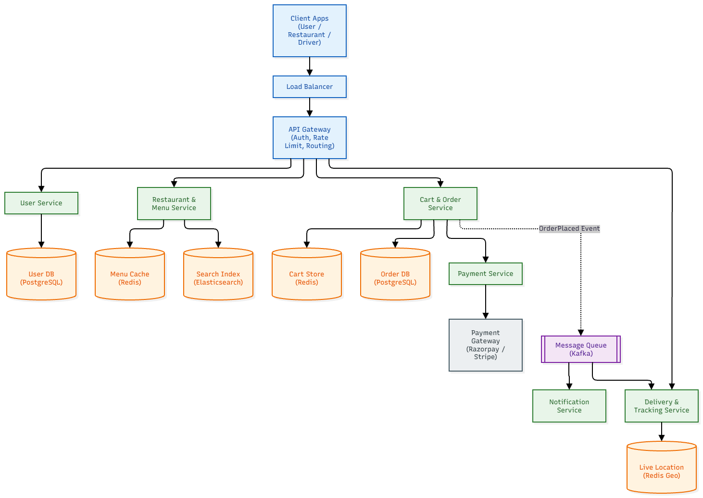
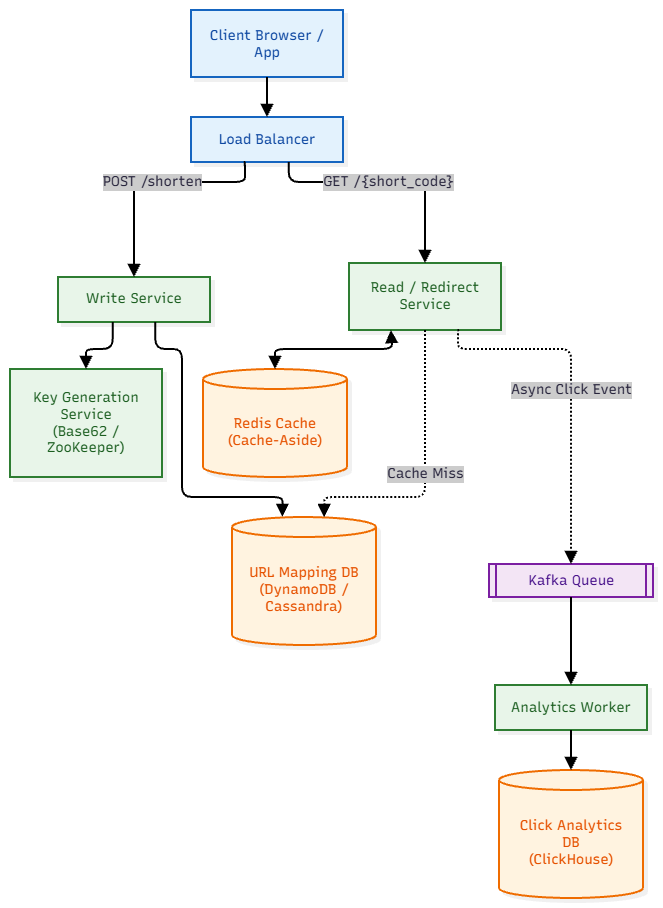

# System Design: High-Level Architecture (HLD)

High-Level System Design architectures created in **draw.io**, covering core distributed systems concepts: API gateways, microservices decomposition, caching strategies, message queues, and fault tolerance.

📂 **Editable Source File:** [`system-design-hld.drawio`](./system-design-hld.drawio)

---

## 1. Food Delivery System (Swiggy / Zomato)

### Key Architectural Highlights
* **User & Menu Browsing:** JWT/OAuth2 authentication via `User Service` (PostgreSQL), paired with **Redis** menu caching and **Elasticsearch** for low-latency restaurant discovery.
* **Cart & Order Flow:** Active carts stored in **Redis**; confirmed orders persisted in an ACID-compliant **PostgreSQL** database and published as `OrderPlaced` events to **Kafka**.
* **Payments & Live Tracking:** Idempotent payment processing via webhooks (Razorpay/Stripe) and real-time delivery partner location updates streamed to **Redis Geo**.

---

## 2. Notification System
.png)

### Key Architectural Highlights
* **Multi-Channel Isolation:** Separate **Kafka** queues for Email (SendGrid/SES), SMS (Twilio), and Push (FCM/APNs) prevent slow providers from blocking high-priority alerts.
* **Preferences & Logs:** User opt-in preferences stored in **PostgreSQL**, with high-throughput delivery logs (`Queued`, `Sent`, `Delivered`, `Failed`) written to **Cassandra**.
* **Fault Tolerance:** Failed deliveries route to a **Retry Queue** with exponential backoff before moving to a **Dead Letter Queue (DLQ)** for alerting.

---

## 3. URL Shortener (Bitly)

### Key Architectural Highlights
* **Collision-Free Key Generation:** 7-character **Base62** short codes ($62^7 \approx 3.5\text{T}$ combinations) backed by a distributed Key Generation Service (ZooKeeper/Redis).
* **Low-Latency Redirection:** Cache-Aside pattern using **Redis** in front of **DynamoDB/Cassandra**, returning **HTTP 302** redirects so every click can be tracked.
* **Async Click Analytics:** Redirect requests publish click events asynchronously to **Kafka**, keeping redirect latency minimal while aggregating analytics in **ClickHouse**.
